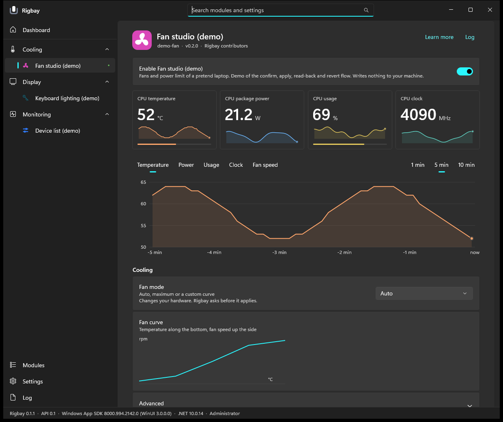
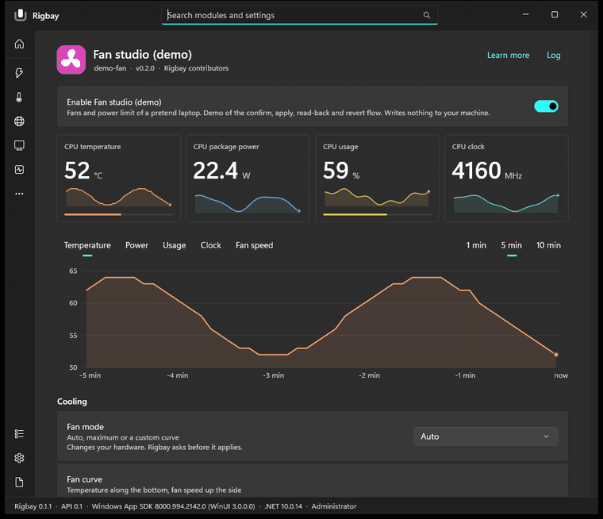
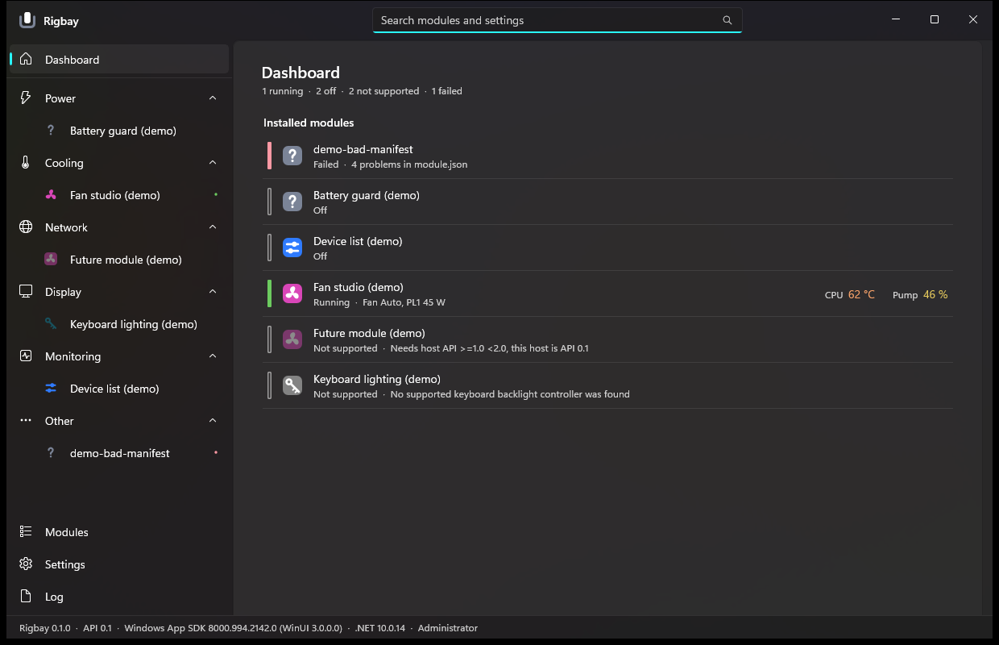
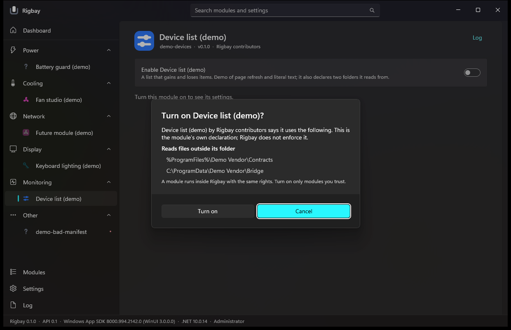
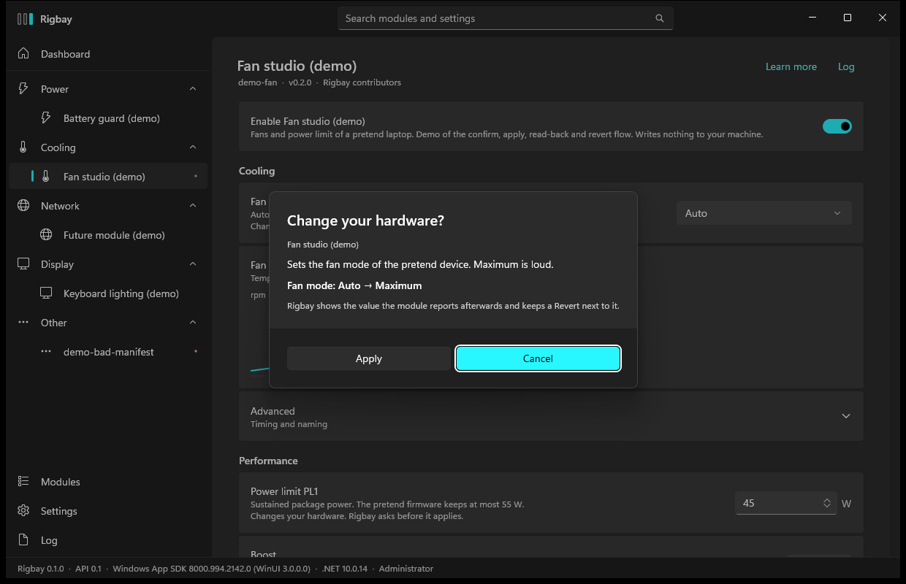

# Rigbay

A small Windows app that manages **modules** for your own machine: power limits, fan and performance
modes, monitoring and logging, network fixes, and anything else a module can do. Each module lives in its
own repository and can be installed, updated or removed from inside the app.

Status: **pre-release (v0.1.2).** The host app, the module contract and the core run and are tested; the first modules (XTU profiles, PredatorSense,
recorder, Steam access) are released separately. See Install below.





<sub>Screenshots are rendered from the app window by `tools/shots.ps1` against the demo modules of this repository, not real hardware modules. The numbers are made up by the demo module. Light theme and Vietnamese versions are in `tools/shots/` (for example `visual-module-light.png`, `module-vi-dark.png`, `dashboard-light.png`, `dashboard-vi-dark.png`).</sub>

## Install

**v0.1.2 is a pre-release.** It needs Windows 11 (x64), the .NET 10 runtime and the Windows App Runtime 1.8; the installer checks them and offers to
install them with `winget`. The files are **not code-signed**, so Windows SmartScreen may warn. Compare the SHA-256 in the
[release notes](https://github.com/rigbay-app/rigbay/releases) with the zip you downloaded.

1. Download `Rigbay-0.1.2-win-x64.zip` from the [latest release](https://github.com/rigbay-app/rigbay/releases) and extract it.
2. In an administrator PowerShell, in the extracted folder: `powershell -ExecutionPolicy Bypass -File .\install.ps1` (add `-WhatIf` to see the steps first).
3. Start **Rigbay** from the Start menu, open **Modules**, press **Check for modules**, install a module, restart, turn it on.

The script copies the app to `C:\Program Files\Rigbay`, creates `C:\ProgramData\Rigbay\modules` (administrators only), adds a Start menu shortcut, an optional
"start at logon" task (`-NoTask` skips it) and an Uninstall entry. Nothing else is changed. `uninstall.ps1` removes all of that and keeps your modules and
settings unless you add `-RemoveData`. Details, the first run, troubleshooting and what each dialog means: [docs/USER-GUIDE.md](docs/USER-GUIDE.md).

| Dashboard | Turning a module on | Changing hardware asks first |
| --- | --- | --- |
|  |  |  |

The same three screens in the light theme: [dashboard](tools/shots/dashboard-light.png), [turn-on dialog](tools/shots/requires-light.png), [hardware confirmation](tools/shots/approval-light.png). Vietnamese: [dashboard](tools/shots/dashboard-vi-dark.png), [a module page](tools/shots/module-vi-dark.png).

What changed in each release: [CHANGELOG.md](CHANGELOG.md).

## Why

Tools like Intel XTU, Acer PredatorSense and one-off fixes each have their own window, their own tray icon and
their own way of starting with Windows. Rigbay gives them one place, one look (WinUI 3, Fluent, Mica), one
settings store, one set of hotkeys and one log, and lets people write a module for *their* machine (other brands,
other CPUs and GPUs, other features) without forking the app.

## What is here

| Path | What |
| --- | --- |
| `src/Rigbay.Abstractions` | The small, versioned contract a module references (module lifecycle, declarative page model, metrics bus, host services). No UI-framework types. |
| `src/Rigbay.Core` | Module discovery and loading (one load context per module), fault boundary, settings, localisation, logging, hotkey/tray/command registries. |
| `src/Rigbay.App` | The WinUI 3 shell: dashboard, module pages, search, tray, hotkeys, toast, command line, start with Windows. Unpackaged, runs as administrator. |
| `src/Rigbay.LangCheck` | Checks language files (`key = text`). |
| `samples/Rigbay.SampleModule` | A minimal module, the template for module authors. |
| `tests/` | Core tests (`dotnet test`). |
| `modules/` | Modules in development (`predatorsense`, `xtu`). Each builds with `Rigbay.sln` and is also published as its own repository in the organisation. |
| `docs/` | Design notes, the module contract (`ABSTRACTIONS.md`), the UI direction, the app guide, spike reports. |
| `tools/` | App build, run and screenshot scripts, demo modules. |
| `spike/` | The UI-framework and XTU runtime spikes (kept as evidence). |

## Planned and in-progress modules

| Module | Source | State |
| --- | --- | --- |
| XTU profiles (Intel power limits, hotkeys, auto-switch, monitor) | [xtu-profile-switcher](https://github.com/minhdevtree/xtu-profile-switcher) | standalone app works; module port in progress |
| Acer PredatorSense (fan mode, sensors) for Predator laptops | new | interface read, first writes verified on one machine; module in progress |
| Steam access (DNS / DPI workaround for networks that block Steam) | [steam-bypass](https://github.com/minhdevtree/steam-bypass) | standalone app works |

## Build and run

Needs Windows 11, the .NET 10 SDK, and the Windows App Runtime 1.8 installed.

```powershell
dotnet build Rigbay.sln
dotnet test Rigbay.sln
.\tools\build.ps1            # app + demo modules into tools\out
.\tools\selftest.ps1         # elevated in-app self-test
```

See [docs/APP.md](docs/APP.md) for running, screenshots and where logs and settings live, and
[docs/ABSTRACTIONS.md](docs/ABSTRACTIONS.md) for the module contract. To write your own module, start with the tutorial
[docs/WRITING-A-MODULE.md](docs/WRITING-A-MODULE.md) and the template repository
[rigbay-app/module-template](https://github.com/rigbay-app/module-template).

## Safety

Modules run **inside the app as administrator**, so install only modules you trust. Rigbay shows what a module
declares it uses, but this is information, not a sandbox. Anything that changes hardware (fans, power limits,
modes) asks first and shows what it will do. The PredatorSense work is based on reading software installed on the
author's own machine; no vendor files or decompiled code are included here, and the findings are written
in our own words.

## License

MIT, see [LICENSE](LICENSE).
