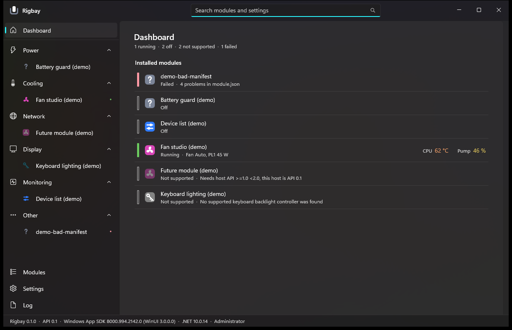
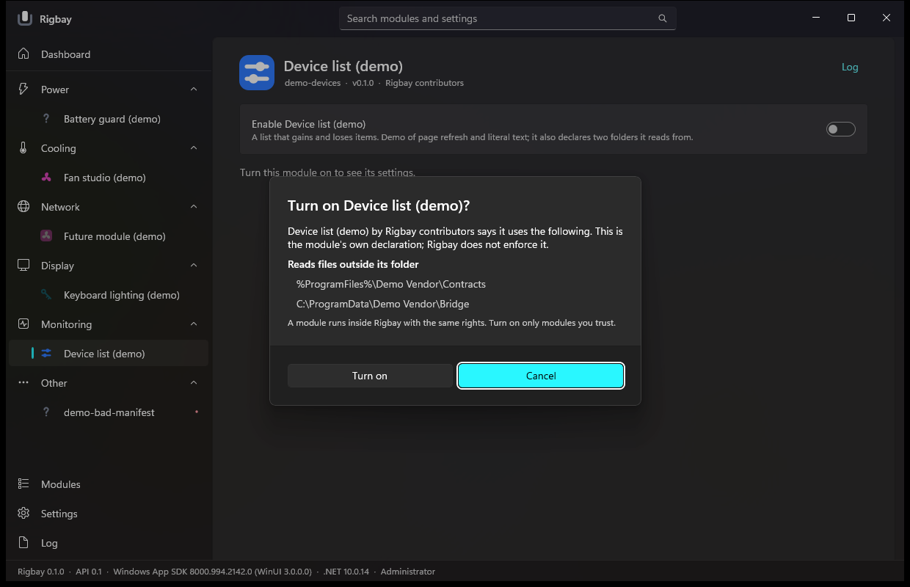
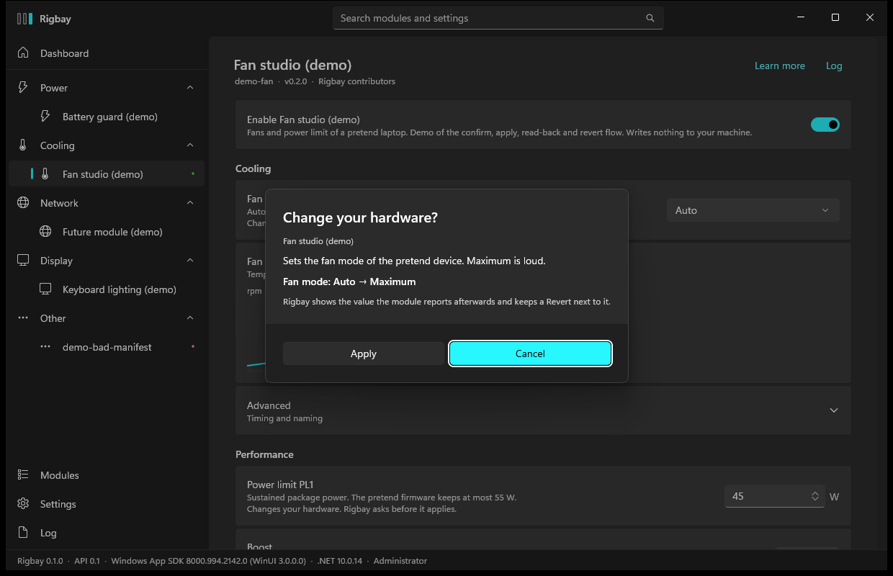

# Rigbay user guide

How to install Rigbay, use it the first time, and take it off again. For how the app works inside see [APP.md](APP.md); for how modules are installed and
what that protects see [INSTALL.md](INSTALL.md).

Rigbay is a small Windows app. On its own it does nothing to your PC: every feature comes from a **module** (power limits, fan modes, a recorder, a Steam
network fix, ...) that you install and turn on yourself.

## 1. What you need

- Windows 11, 64-bit (x64). Windows on ARM is not supported in 0.1.
- The **.NET 10 runtime** and the **Windows App Runtime 1.8**. Rigbay does not carry them (the installer script checks, and offers to install them with
  `winget`). Only the base .NET runtime is needed, not the Desktop runtime.
- An administrator account. Rigbay runs as administrator because the hardware modules need it. Windows asks for permission each time you start it by hand
  (the start-at-logon task below starts it without a prompt).

## 2. Install

1. Download `Rigbay-0.1.1-win-x64.zip` from the [releases page](https://github.com/rigbay-app/rigbay/releases) and compare its SHA-256 with the one in the release
   notes: `Get-FileHash .\Rigbay-0.1.1-win-x64.zip -Algorithm SHA256`.
2. Extract the whole zip to a folder, for example your Downloads. Do not extract into `C:\Program Files` yourself.
3. Open **Windows PowerShell as administrator** (right-click Start, "Terminal (Admin)"), go to that folder and run:

   ```powershell
   powershell -ExecutionPolicy Bypass -File .\install.ps1
   ```

   If you forget the administrator window, the script says so and opens one for you. Add `-WhatIf` to see every step without changing anything.

**The files are not signed.** Windows SmartScreen may show "Windows protected your PC" when you first run the downloaded `install.ps1` or the app. Check the
hash (step 1), then choose "More info" and "Run anyway", or right-click the zip before extracting, Properties, "Unblock". Signing needs a certificate
that the project does not have yet.

### What the script does

| Step | Detail |
| --- | --- |
| Checks | Windows 11 build, x64, .NET 10 runtime, Windows App Runtime 1.8. For anything missing it names the package, shows the `winget install --id ...` line and **asks** before running it (`-InstallPrerequisites` answers yes for you). |
| Program files | Copies the app to `C:\Program Files\Rigbay` (`-Root <folder>` for another place). A running Rigbay is asked to quit first. Running it again over an older version is an upgrade; your settings and modules are not touched. It refuses a non-empty folder that is not a Rigbay install. |
| Modules folder | Creates `C:\ProgramData\Rigbay\modules`, writable only by Administrators and SYSTEM (the same rule the app applies itself, because a module runs as administrator). |
| Start menu | A shortcut named Rigbay (`-NoShortcut` to skip). |
| Start at logon | A scheduled task named `Rigbay`: starts Rigbay in the tray when you sign in, 15 seconds after, with highest privileges so there is no prompt (`-NoTask` to skip; the same switch is in Settings). |
| Installed apps | An entry in Settings, Apps, Installed apps, with an Uninstall button. |
| Nothing else | No other folder, service, driver or registry key is changed. |

Switches: `-Root`, `-NoTask`, `-NoShortcut`, `-InstallPrerequisites`, `-NoUninstallEntry`, `-WhatIf`. `Get-Help .\install.ps1 -Full` lists the rest.

An empty `modules` folder sits next to `install.ps1`. If you put a module folder in it (one that has a `module.json`) the installer copies it to the modules folder. You
do not need this: the app installs modules itself (section 3).

## 3. First run

Start **Rigbay** from the Start menu and accept the Windows permission prompt. With no modules the dashboard says so, in one line each: where Rigbay looked, and that a
module you install appears after one restart. The button **Open Modules** goes to the Modules page. (The first start opens that page by itself, once.)

1. On the Modules page press **Get the module list**. Rigbay reads the list from `github.com/rigbay-app/registry`, only when you ask, and sends no account, machine
   name or identifier. (**Check for module updates every day** in Settings is off by default.)
2. Each available module shows what it declares it uses and its size. Press **Install** on one. The download is checked against its SHA-256 before anything is unpacked.
3. A bar says **Restart required**. Press **Restart now**. Installing, updating and removing a module always needs one restart, because a running module cannot be replaced.
4. After the restart the module is in the list, **turned off**. A module never runs until you turn it on.



## 4. Turning a module on

Open the module's page and use the **Enable** switch. The first time, Rigbay shows what the module says it uses:



- **Administrator rights** — it needs them (Rigbay always has them).
- **Network** — it opens ports or talks to servers; the addresses are listed.
- **Registry** — it reads or writes these keys.
- **Services** — it uses these Windows services.
- **Reads files outside its folder** — it loads files from these places (for example another vendor's program).

This is **the module's own statement**. Rigbay shows it so you can decide; it does not enforce it, and a module runs inside Rigbay with the same rights as Rigbay
(administrator). Turn on only modules you trust. If an update of a module declares more than the version you accepted, it stays off after the update and asks again.

## 5. When a module changes your hardware

A module may only change your hardware (fan mode, power limits, a Windows setting) after Rigbay has asked you, with the exact change:



- The dialog names the module, says what it does, and shows the change as "Fan mode: Auto → Maximum".
- **Apply** makes the change; **Cancel** changes nothing.
- Afterwards Rigbay shows the value the module reports back and keeps a **Revert** button next to it. Reverting is asked about too.
- A change that cannot be undone from Rigbay says so in the dialog.
- Command-line use (`Rigbay.App.exe <module> <verb>`) with no window open refuses every hardware change; there is nobody to ask.

Rigbay and its modules never write to the firmware unless you pressed Apply for that change.

## 6. Start with Windows

The installer creates the task unless you used `-NoTask`. **Settings → Start with Windows** switches it on or off at any time and shows whether the task is set. The task
starts `Rigbay.App.exe --tray`: Rigbay starts hidden in the notification area. The close button of the window also hides to the tray; **Quit** is in the tray menu. Starting
Rigbay a second time brings the first window forward.

## 7. Update Rigbay

Run `install.ps1` from the newer zip, the same way as section 2. It quits the running Rigbay, replaces the program files and leaves your settings and modules alone.
`Rigbay.App.exe --version` prints the installed version; Settings shows it too, with a link to the source. Modules are updated from the Modules page, not by this script.

## 8. Uninstall

Settings → Apps → Installed apps → Rigbay → Uninstall, or in an administrator PowerShell:

```powershell
powershell -ExecutionPolicy Bypass -File "C:\Program Files\Rigbay\uninstall.ps1"
```

It quits Rigbay (the normal way, so modules can put back what they changed), removes the scheduled task, the Start menu shortcut, the Installed apps entry and the program
folder. **It keeps** your modules (`C:\ProgramData\Rigbay\modules`) and your settings, hotkeys and logs (`%LOCALAPPDATA%\Rigbay`), so installing again brings them back.
`-RemoveData` deletes those two as well. `-WhatIf` lists the steps without doing them.

A module that changed a Windows setting (the Steam module sets a proxy script address) puts it back when you turn it off or when Rigbay quits normally. Turn such modules off
**before** uninstalling.

## 9. Where things live

| What | Where |
| --- | --- |
| Program | `C:\Program Files\Rigbay` |
| Modules | `C:\ProgramData\Rigbay\modules\<id>` (admin-only); download and staging work in `C:\ProgramData\Rigbay\modules.install` |
| Log | `%LOCALAPPDATA%\Rigbay\logs\rigbay.log` (rotating, 1 MiB, 3 files). The Log page shows the same; Settings has **Open folder**. |
| Settings | `%LOCALAPPDATA%\Rigbay\app.json` (theme, log level, daily check), `host.json` (language, which modules are on), `hotkeys.json` |
| Module settings and data | `%LOCALAPPDATA%\Rigbay\modules\<id>` |
| Your own language files | `%LOCALAPPDATA%\Rigbay\lang\*.lang` (add a language or change words; English and Vietnamese are built in) |

## 10. Troubleshooting

**Rigbay does not start, or the window never appears.** Run `"C:\Program Files\Rigbay\Rigbay.App.exe" --version`. If that prints `Rigbay 0.1.1` the app starts and the
trouble is the window: the Windows App Runtime 1.8 is probably missing or broken. Run `install.ps1` again (it checks) or
`winget install --id Microsoft.WindowsAppRuntime.1.8 -e`. If `--version` itself fails, install the .NET 10 runtime: `winget install --id Microsoft.DotNet.Runtime.10 -e`.

**The window is not there but Rigbay runs.** It may be in the tray (the close button hides it). Start Rigbay again from the Start menu: it shows the first one.

**A module is red (failed).** Its row says why. The Log page has the detail. A module that fails is turned off by Rigbay and does not take the app down; turn it on again
once the cause is gone, or remove it on the Modules page. After a bad update the details offer **Go back to the earlier version**.

**Installing a module fails with "hash mismatch" or "unsafe zip".** Rigbay refused a file that is not what the list described. Do not work around it; try again later and
tell the module's author if it stays.

**Steam access (module `steam-bypass`) and the old Steam Bypass app cannot run together.** Both listen on `127.0.0.1:18081` and `127.0.0.1:80` and both set the Windows
*automatic configuration script* of the current user. Quit the old app and switch off its start-with-Windows **before** turning the module on; after that use only one of them.
The module only undoes what it set itself, so it will not remove the old app's setting, and the old app's own restore may remove the module's.

**PredatorSense module.** Needs an Acer Predator laptop with Acer PredatorSense installed (its service `PSSvc` present) and the firmware's `AcerGamingFunction` WMI class.
The module reads temperatures and fan speeds and can set the fan mode to Auto or Maximum, after you confirm. It was tried on one machine only (Predator Triton 500 SE); on
another model the page says "not supported" or shows the reason. PredatorSense itself may re-apply its own mode after sleep or a restart; that was not tested.

**XTU module.** Needs an Intel CPU and **Intel Extreme Tuning Utility** installed, with its service (`XTU3SERVICE`) running; the module talks to that service and brings no
Intel files. Without it the module says why it is not supported. Changing power limits is a hardware change and is confirmed each time. The old standalone XTU
profile switcher sets power limits too; using one tool at a time is safer.

**Windows SmartScreen or antivirus warns.** The files are not code-signed. Check the SHA-256 against the release notes before you run them.

**You want to report a problem.** Open an issue on [github.com/rigbay-app/rigbay](https://github.com/rigbay-app/rigbay) with the version (`Rigbay.App.exe --version`) and the last
lines of the log. Look through the log first: it can contain names of your folders and modules.
