# Rigbay UI review, November 2026

Task U1, job rigbay-5. Reviewer: design review (Opus), using the `impeccable` (critique and native audit),
`design-taste-frontend` (app screens) and `dataviz` skills, applied to WinUI 3. Review only: no product code was changed.

Reviewed: `main` at `5c2f4a2` (V1 visual readings and the Remote tunnel module merged). The four released modules
(XTU 0.1.0, PredatorSense 0.1.1, Steam access 0.1.1, Recorder 0.1.0, downloaded from their GitHub releases and checked
against the registry SHA-256) and the Remote tunnel module's demo build (a made-up machine, tunnels `example-tunnel` and
`example-backup`). One comparison render of the XTU page from `aa196e1`, the commit before V1.

## Verdict

Rigbay is built the right way underneath: one page model, honest states, an approval before every write, a Revert
after it. V1 fixed the biggest gap the owner named: readings are now tiles, sparklines and a trend chart.

What the owner feels as "too much text" comes from three things. More charts would not fix any of them:

1. **The module's main job is not at the top.** XTU's profile picker, PredatorSense's fan mode, the Steam bypass switch,
   the Recorder's Start button and the tunnel switches are all below the fold, under readings or inside a closed expander.
   Acer's app wins this comparison because its mode picker is big and first.
2. **The same fact is said several times.** XTU shows the active profile in three rows. V1 now shows each reading three
   times (tile, chart, row). Every hardware row repeats "Changes your hardware. Rigbay asks before it applies."
3. **Rows that say nothing.** "Last action: No change made yet", six Recorder rows of "–", Steam tiles that read "Not
   available" above an empty chart, a status bar of SDK versions on every screen.

One defect blocks use: at a window width of 640 px or less (a snapped half screen) the navigation pane disappears and no
button brings it back. At the same width a Dashboard row can lose its module's name.

The fix is mostly the host's, so every module gets it: a header card that carries the switch and the live state, a
**primary control** slot in the page model drawn large under it, the **tiles as the chart's tabs**, and rows that only
appear when they carry something. Three work packages below can be built in parallel without touching the same files.

**Counts:** 1 P0, 16 P1, 38 P2, 5 P3 (60 findings). Fix order: SH-1 (the P0), then the P1s MP-1, VR-1, XT-1,
PS-1, TN-1, SA-1, RC-1, VR-2, VR-3, MP-2, DB-1, DB-2, DB-7, SH-2, AX-1, AX-2.

## Contents

- [How this was checked](#how-this-was-checked)
- [Scores](#scores)
- [What works](#what-works)
- [Screens as they are](#screens-as-they-are)
- [Findings](#findings)
- [Before and after sketches](#before-and-after-sketches)
- [Work packages](#work-packages)
- [Not verified](#not-verified)

## How this was checked

- Every screen was rendered from the app's own window (`--shot`, PrintWindow of its HWND; never the screen) with
  `--script`, `--page`, `--theme`, `--lang`, `--size`, `--shot-scale` and `--time-scale 6` (so the charts have minutes
  of history after half a minute). Scratch data folders under `C:\Rigbay-u1`, so no user or machine name is drawn.
  The XTU module ran with its `no-write.flag` latch, the Recorder pointed at a scratch folder, and nothing was applied:
  the only hardware access was reading sensors. The Steam access connection test was not run (no real network data).
- 55 renders were made (dark and light, English and Vietnamese, 1240, 1000 and 640 px wide, 100 and 150 %) and about
  40 of them were studied one by one. The ones referenced below are in `img/`, scaled to at most 900 px wide.
- Source read: `src/Rigbay.App` (all of `Ui/`, `MainWindow`, `Services/TrayHost.cs`, `Services/InAppNotice.cs`,
  `Styles.xaml`, `lang/en.lang`), the V1 files (`ReadingBlock`, `ReadingTile`, `TrendChart`), `PageModel.cs`, and the
  page builders of the five modules.
- Compared against Windows 11 Settings, PowerToys Settings and Task Manager's Performance page (all stock Fluent),
  and against Acer PredatorSense as the owner described it (round temperature gauges, big mode picker). The Acer app
  was not opened.

## Scores

Native platform, so the `impeccable` critique runs as a design review only (its web detector does not apply).

| # | Heuristic (Nielsen) | Score | Key issue |
| --- | --- | --- | --- |
| 1 | Visibility of system status | 3 | Honest states and bay bars; but "Not available" noise and no state line in tunnel rows |
| 2 | Match with the real world | 2 | PL1/PL2, host API, manifest, raw `17978 B/s`, exception names on the failed page |
| 3 | User control and freedom | 3 | Revert, Discard, Undo, approval; "Delete profile" has no confirmation |
| 4 | Consistency and standards | 2 | Accent on Cancel in every dialog; two switches on Steam; combo for a 2-way choice |
| 5 | Error prevention | 3 | Approval before every write, ranges on number rows |
| 6 | Recognition rather than recall | 2 | Main controls buried; search lands at the top of a page, not on the row |
| 7 | Flexibility and efficiency | 1 | No keyboard accelerators, no quick actions outside the tray |
| 8 | Aesthetic and minimalist design | 2 | Repeated facts, empty rows, developer status bar |
| 9 | Help users recover from errors | 2 | Exception text and "View log", no Try again |
| 10 | Help and documentation | 2 | A description on every row, too long; nothing short and findable |
| | **Total** | **22/40** | Workable; the gaps are hierarchy and repetition, not missing features |

Native audit (`impeccable` audit, native): accessibility 2, performance 3 (V1 measured about 2 % of a core while a page
with charts is open, 0 while hidden), appearance and theming 3, platform conformance 3, adaptivity 1 (640 px).
**12/20.**

## What works

- **The page model.** One declarative model drawn by the host means every fix below lands in all modules at once. Keep
  it; extend it rather than letting modules draw their own pages.
- **Trust flow.** The approval dialog names the exact change ("Fan mode: Auto → Maximum"), the row then shows the value
  the module reports and a Revert link (`img/24-applied.png`). Keep this flow as it is; the changes below only make
  the dialog's buttons and title clearer (DL-1, DL-2).
- **V1's tiles.** Big number, small unit, sparkline, thin meter, text in ink and hue on the marks; the honest scale
  (minimum span per unit, gaps for missing data) and nothing running while hidden. The choice of tile over a round gauge
  is right (see VR-6).

## Screens as they are

**Dashboard, five real modules.** CPU temperature twice, "Not available" twice, readings in ragged columns.

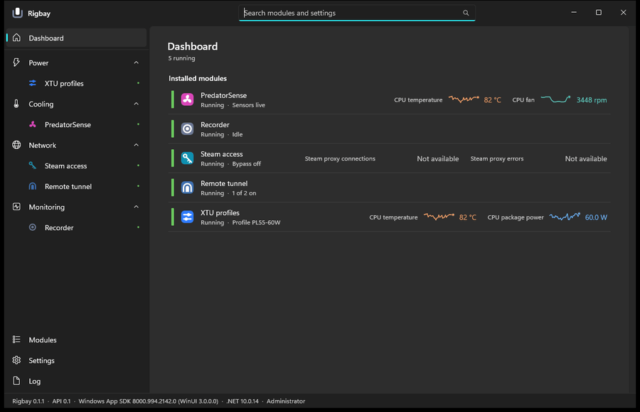

**XTU before V1 (`aa196e1`) and on main.** V1 added tiles and a chart above the rows, which pushed the profile picker
below the fold; the three rows that repeat the active profile are still there.

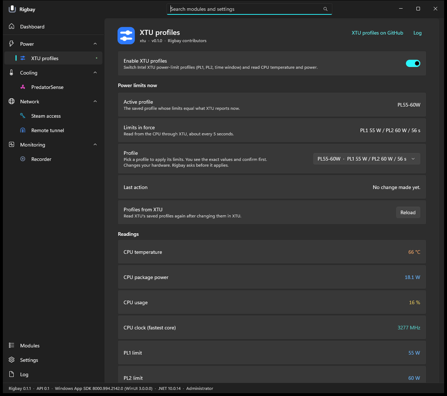

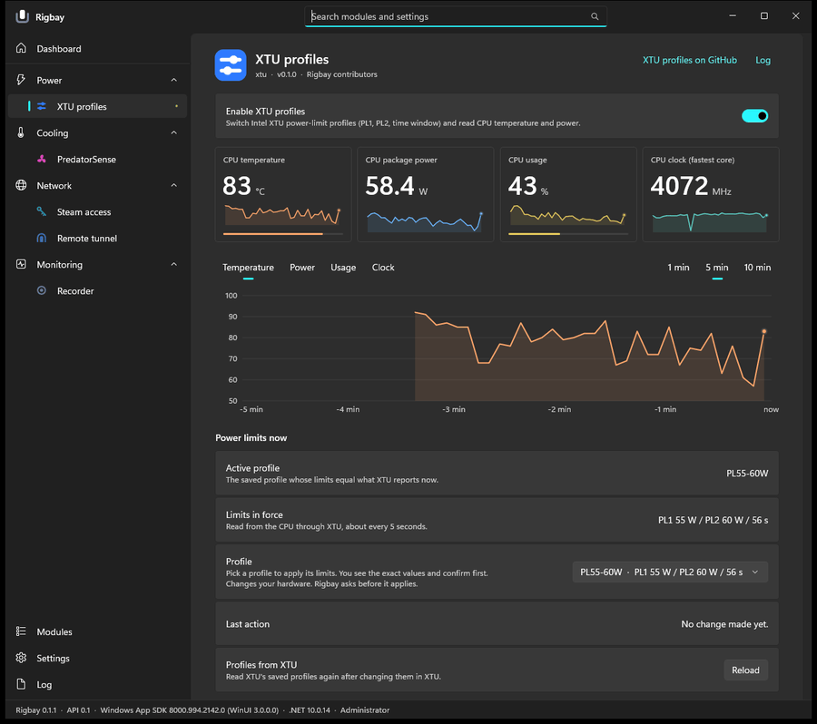

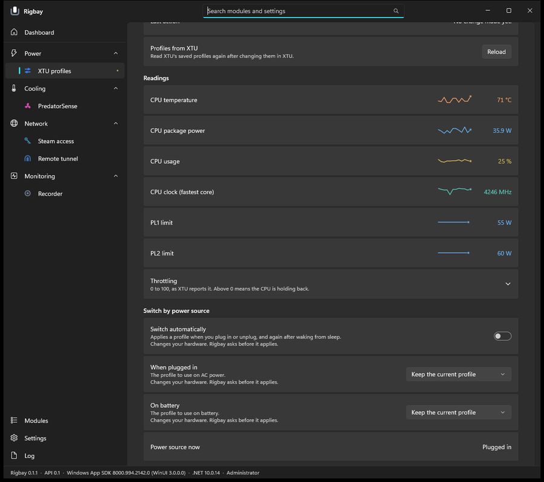

**PredatorSense.** Four tiles, a three-line chart, seven reading rows, then the fan mode.

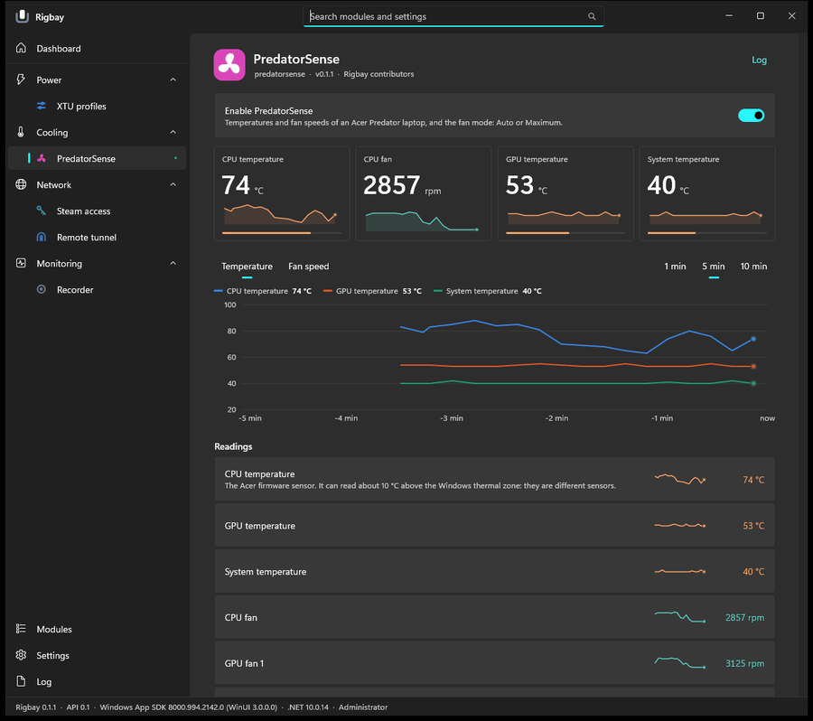

**Steam access.** Two "Not available" tiles and an empty chart above the bypass switch.

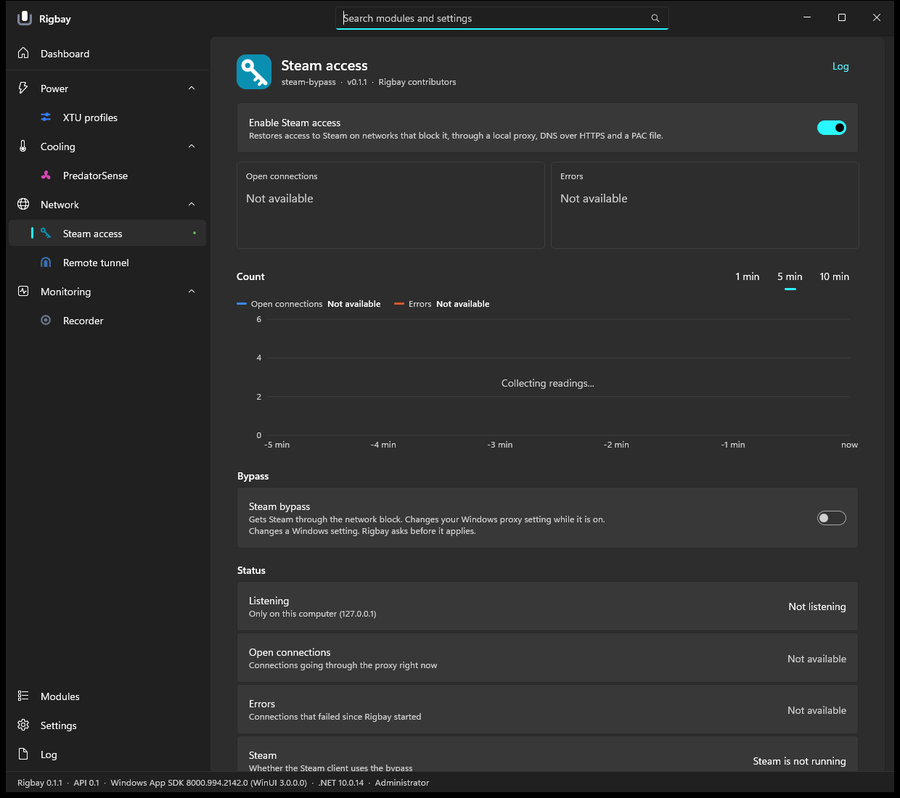

**Recorder.** Start and Stop as two rows, then six rows of "–".

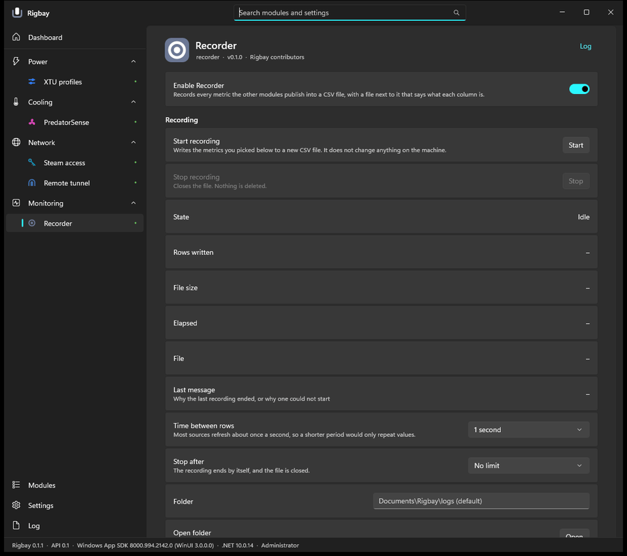

**Remote tunnel (demo build).** Raw byte rates; tunnels as closed expanders with only a name.

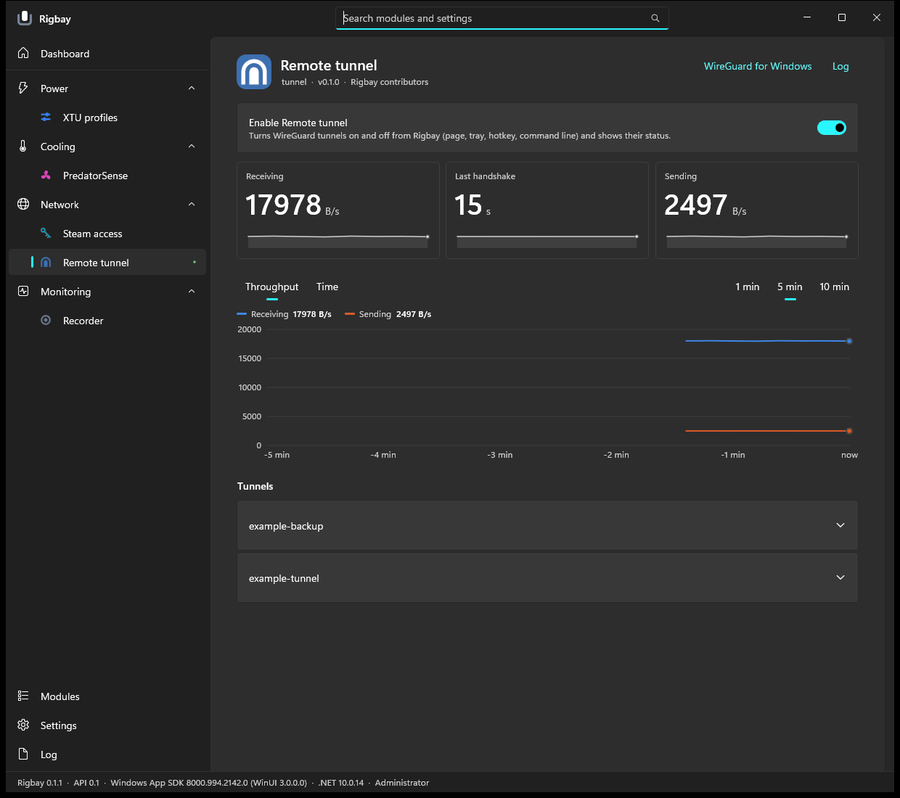

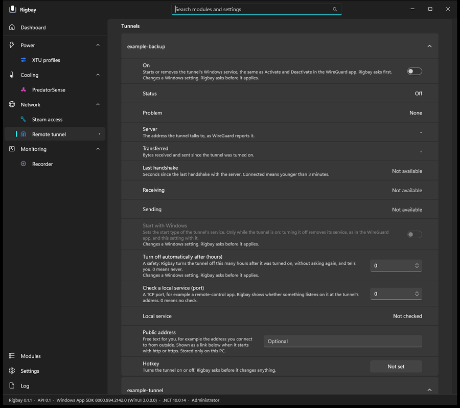

**640 px wide.** No navigation pane and no button to open it; the Steam access row has lost its name.

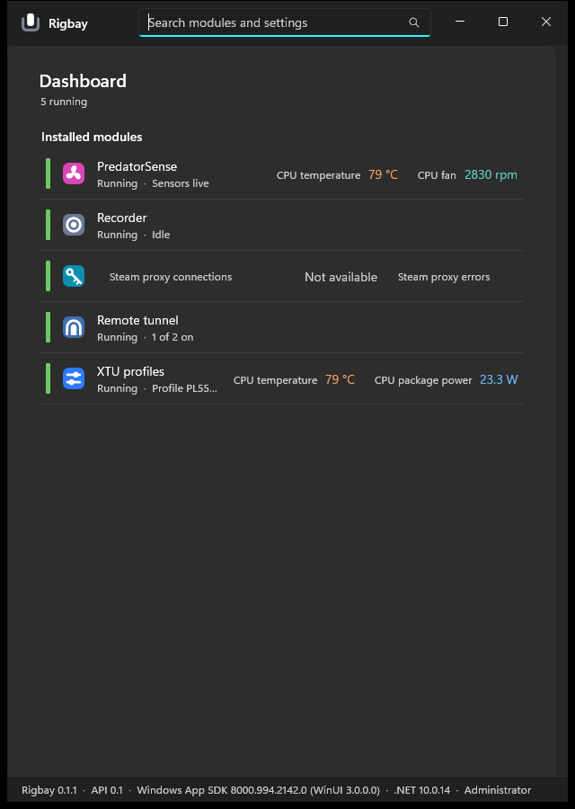

More renders: `img/03-dashboard-empty.png`, `04-first-run.png`, `08-xtu-640.png`, `09-xtu-vi.png`,
`11-predatorsense-lower.png`, `16-module-off.png`, `17-approval.png`, `18-requires.png`, `19-modules.png`,
`20-settings.png`, `21-log.png`, `22-failed.png`, `23-xtu-light.png`, `24-applied.png`, `25-xtu-bottom.png`.

## Findings

Priority: **P0** broken, **P1** hurts every user, **P2** polish, **P3** idea. Effort: **S** under a day, **M** a few
days, **L** a week or more. **V1** = builds on the V1 code now on main. **WP** = work package (below).
Paths are relative to `src/Rigbay.App` unless they start with `src/` or `modules/`.

### Shell, navigation, search

| Id | P | Screen | Finding | Why | Fix | Effort | V1 | WP |
| --- | --- | --- | --- | --- | --- | --- | --- | --- |
| SH-1 | P0 | Every page at ≤ 640 px | The pane switches to Minimal and `IsPaneToggleButtonVisible="False"` hides the only way to open it. Modules, Settings, Log and every module page are unreachable except through search (`img/02-dashboard-640.png`). A window snapped to half of a 1280 px screen, or of 1920 px at 150 %, is 640 px. | Navigation must always be reachable (Fluent `NavigationView` guidance; Windows Settings keeps its back and menu buttons). | `MainWindow.xaml` `Nav`: set `IsPaneToggleButtonVisible="True"` and `CompactModeThresholdWidth="500"`, so the icon rail stays down to 500 px and the menu button appears below it. Set a minimum window width of 500 (`OverlappedPresenter.PreferredMinimumWidth` in the `MainWindow` constructor). | S | no | A |
| SH-2 | P1 | Every page | The status bar shows `Rigbay 0.1.1 · API 0.1 · Windows App SDK 8000.994.2142.0 (WinUI 3.0.0.0) · .NET 10.0.14 · Administrator` on every screen. | Developer facts are noise for the user and take 28 px of every page; Windows Settings and PowerToys have no status bar. | Remove row 2 of `MainWindow.xaml` and `MainWindow.UpdateStatus`. Put the versions in Settings > About with a "Copy version info" button (for bug reports). Show "Not running as administrator" as an `InfoBar` only when it is true. | S | no | A |
| SH-3 | P2 | Title bar | No keyboard accelerator exists anywhere; UI-DIRECTION promised Ctrl+F for search. | Keyboard users and power users (heuristic 7). | `MainWindow.xaml.cs` `OnLoaded`: add `KeyboardAccelerator` Ctrl+F (and F3) on `Root` that focuses `Search`; placeholder "Search (Ctrl+F)". | S | no | A |
| SH-4 | P2 | Search | Picking a setting in the results opens the module page at the top; the user has to find the row again. Results are plain text, 8 at most. | Windows Settings scrolls to the setting and highlights it. | `SearchItem` gets the row's header key; after `ShowCurrent`, find the `SettingsCard` whose header matches, `StartBringIntoView`, focus it. Show the module glyph and the group in each result. | M | no | A |
| SH-5 | P2 | Navigation pane | Groups (Power, Cooling, Network, Monitoring) hold one or two modules each: 9 items for 5 modules. Under 1000 px only the group icons stay, so a module takes a flyout to reach. | A level of hierarchy that carries no choice. PowerToys groups 25 tools; Rigbay has 5. | `MainWindow.BuildNav`: list modules flat, each with its quiet glyph, under a "Modules" header while there are 8 or fewer; use the groups only above 8. | S | no | A |
| SH-6 | P2 | Navigation pane | Every running module has a green dot (5 dots on the real machine). | A signal that is always on carries nothing; the red dot of a failed module is drowned. | `BuildNav`: drop `SuccessDotInfoBadgeStyle`; keep the critical dot for failed and the attention dot for update or restart. | S | no | A |

### Dashboard

| Id | P | Screen | Finding | Why | Fix | Effort | V1 | WP |
| --- | --- | --- | --- | --- | --- | --- | --- | --- |
| DB-1 | P1 | Dashboard | The home page is a list. The machine's state (CPU 82 °C, fans, power) is small text at the right of two rows, and CPU temperature appears twice (XTU and PredatorSense) (`img/01-dashboard.png`). This is the screen the owner opens first and calls "nothing visual". | The screen's first question is "how is my PC right now"; its answer should be the biggest thing (design-taste app screens 2.2). | `DashboardPage.Build`: a "This PC now" strip above the rack: one `ReadingTile` (V1, unchanged) per summary reading of each running module, at most 6, one per label (first module wins), click opens the module. Sketch 2. | M | yes | A |
| DB-2 | P1 | Dashboard | Steam access, bypass off: its row shows "Steam proxy connections Not available · Steam proxy errors Not available". | Two alarms for a feature that is simply off. | `DashboardPage.Reading`: leave out a reading that is not available (`ReadingFormat.IsAvailable` false); show none rather than a placeholder. | S | yes | A |
| DB-7 | P1 | Dashboard at 640 px | The readings column is `Auto` and the name column is `*`, so wide readings win: Steam access loses its name and state line entirely, its second reading is cut, XTU's state is cut to "Profile PL55…" (`img/02-dashboard-640.png`). | A row that does not say which module it is cannot be used. | `DashboardPage.Row`: below 760 px row width, move the reading strip under the name (second line) instead of beside it; never let the name column go under 160 px (`MinWidth` on the text stack). DB-2 also removes the "Not available" that triggers it here. | S | yes | A |
| DB-3 | P2 | Dashboard | Readings sit at different x positions per row; labels come from long descriptors ("CPU package power", "Steam proxy connections"). | A rack reads down its columns; ragged columns cannot be compared. | `DashboardPage.Row`: two fixed reading slots (160 px each, right-aligned, label above value), short label from `metric.<id>.short` with the long one in the tooltip. | S | yes | A |
| DB-4 | P2 | Dashboard | No module can be controlled from the Dashboard: changing a profile or the fan mode needs the module page. | Acer's main screen is a mode picker; the most frequent job should be one click away. | After MP-1 lands: render the module's primary row (MP-1) at the row's right, through the same `RowRenderer` (same approval and Revert). Sketch 2. | M | yes | A, after B |
| DB-5 | P2 | Dashboard | State lines: PredatorSense "Sensors live", Recorder "Idle". | The line should say the state of the thing, not of the module. | Module copy (see PS-4, RC-1); the host already shows whatever `PageSummary.StateLine` says. | S | no | B2 |
| DB-6 | P2 | Dashboard, no modules | "Rigbay looked in C:\…\modules and found no module folders. A module is a folder with a module.json and its DLL." (`img/03-dashboard-empty.png`) | Written for a developer; since R1 users install from the list. | `dash.empty-*`: "No modules yet" / "Modules add fan, power and network controls. Pick the ones for this PC." / button "Browse modules". | S | no | C |

### Module page: the host's skeleton and renderer

| Id | P | Screen | Finding | Why | Fix | Effort | V1 | WP |
| --- | --- | --- | --- | --- | --- | --- | --- | --- |
| MP-1 | P1 | Every module page | The main job is not first. XTU: the profile picker is the 3rd row under tiles and chart; V1 moved it from 440 px to 870 px down the window, below the fold of the default 800 px window (`img/05-xtu-before-v1.png` and `06-xtu.png`). PredatorSense: fan mode is under 7 reading rows. Steam: the bypass switch is under two "Not available" tiles and an empty chart. Recorder: Start is a row among 13. Tunnel: the switches are inside closed expanders. | The most frequent job should be one click away and the biggest control (design-taste 2.2); the owner's comparison with Acer is exactly this. | `src/Rigbay.Abstractions/PageModel.cs`: add `PageModel.Primary` (one `Row`, optional). `ModulePage.Build` draws it in a hero card right under the header, before the readings. `RowRenderer.RenderPrimary`: a `ChoiceRow` with 2 to 5 short options becomes a `Segmented` control (CommunityToolkit `Segmented`, as PowerToys uses) or large `RadioButtons` cards; a `ToggleRow` a large switch with its state line; a `ButtonRow` an accent button. Same editor, approval and Revert as today. Sketches 1 and 3. | M | no | B |
| MP-2 | P1 | Every hardware row | Each row that writes adds a second line "Changes your hardware. Rigbay asks before it applies." (4 times on the XTU page, twice on Steam access as "Changes a Windows setting…"). | The owner's "too much text"; a rule said once is enough. | `RowRenderer.Card`: replace the line by a small glyph after the header (Segoe Fluent Icons shield, 12 px, secondary) with the sentence as its tooltip and UIA help text. Say it once in the header card's description. | S | no | B |
| MP-3 | P2 | Every module page | The page header (tile, name, `id · v0.1.0 · Rigbay contributors`) is followed by an "Enable XTU profiles" card that repeats the name and the manifest description. | Two blocks for one thing; id, version and author are facts for the Modules page. | `ModulePage.Build` and `EnableCard`: one header card (Windows Settings' Bluetooth card): tile, name, live state line (`PageSummary.StateLine`) with a state dot, the switch at the right; links small at the top right. Id, version, author move to the Modules page details. Sketch 1. | S | no | B |
| MP-4 | P2 | Rows of status | `ValueRow`s that say nothing in the normal case: XTU "Last action: No change made yet", PredatorSense "Last set by Rigbay: Nothing yet" and "Speed check: No change made yet", Steam "Last problem: None", Recorder six rows of "–". | Empty rows are the biggest part of the "text"; a row should appear when it has something to say. | Host rule in `RowRenderer.ValueText`: a `ValueRow` whose value is empty is collapsed, and comes back when the value changes. Modules then publish "" instead of "None" or "–" (B2). | S | no | B |
| MP-5 | P2 | Choices | A 2-option choice (fan mode Auto/Maximum, plus a fake "Not set" item) is a combo box. | A segmented control shows both options and is one click (Fluent: radio buttons or segmented for 2 to 5 options). | `RowRenderer.Choice`: options ≤ 4 and every label ≤ 16 characters → `Segmented`; no selection allowed when the module's value is not one of the options (replaces PredatorSense's "Not set" item). | S | no | B |
| MP-6 | P2 | Expanders | An `ExpanderRow` cannot carry a control or a live line in its header, so a tunnel's switch and status are hidden until it is opened; the same for XTU's custom profiles. | The state of each item must be visible in the list (heuristic 1). | `PageModel.cs`: `ExpanderRow.HeaderRow` (a toggle or button drawn as the `SettingsExpander.Content`) and `ExpanderRow.Line` (an observable description). `RowRenderer.Expander` draws them. | S | no | B |
| MP-7 | P2 | Module off | When a module is off, the rows dim but the hardware note keeps full contrast and reads as active (`img/16-module-off.png`). | Disabled must look disabled everywhere in the card. | `RowRenderer.Card`: the note's `Foreground` follows `IsEnabled` (`TextFillColorDisabledBrush`); moot once MP-2 lands. | S | no | B |
| MP-8 | P2 | Failed module | The failed page shows "The module failed in Initialize: InvalidOperationException: …" and only "View log" (`img/22-failed.png`). | Exception names mean nothing to users; recovery needs an action (heuristic 9). | `ModulePage.Build`, Faulted branch: one sentence ("Battery guard stopped while starting."), buttons "Try again" (re-enable) and "View log", and a "Details" expander with the exception, selectable. | S | no | B |
| MP-9 | P2 | Buttons that delete | "Delete profile" (XTU) deletes at once. | A destructive action without a confirmation or an undo. | `PageModel.cs`: `ButtonRow.ConfirmKey`; `RowRenderer.Button` asks with a `ContentDialog` that names the object ("Delete Gaming?", primary "Delete"). | S | no | B |

### Visual readings (V1)

| Id | P | Screen | Finding | Why | Fix | Effort | V1 | WP |
| --- | --- | --- | --- | --- | --- | --- | --- | --- |
| VR-1 | P1 | Pages with readings | Each reading is shown three times: as a tile with a sparkline, in the chart (its tab), and again as a row with its own sparkline below (PredatorSense: 4 tiles, a 3-line chart, then 7 reading rows; `img/10-predatorsense.png`, `11-predatorsense-lower.png`). The chart's tab bar is a second way to choose what the tiles already name. | One figure, one place (design-taste 5); the repetition is what makes the page long. | Task Manager's Performance pattern: **the tiles are the chart's tabs.** `ReadingBlock`/`TrendChart`: clicking a tile (or arrow keys in the strip) selects the chart's series; the selected tile gets a 1.5 px accent border; the `SelectorBar` of groups goes. `RowRenderer.RenderGroups`: a reading that is a tile is not drawn again as a row; the remaining readings go into one "All readings" expander as compact lines (name, sparkline, value; 32 px each). Sketch 1. | M | yes | B |
| VR-2 | P1 | Steam access, any module whose feature is off | Tiles read "Not available" and the chart says "Collecting readings…" above the switch that would make them available (`img/12-steam.png`). The chart group is called "Count". | Visuals of nothing push the control down and look broken. | `ReadingPlan`/`ReadingBlock`: a tile is shown only once its metric has published at least one sample this session; the chart only when one of its series has 2 or more points. A group named only by its unit (`chart.group.count`) takes the reading's own name when it has one series. | S | yes | B |
| VR-3 | P1 | Remote tunnel | Byte rates are raw: tiles `17978 B/s`, `2497 B/s`, chart axis 0 to 20000 with no unit (`img/14-tunnel.png`). | Unreadable numbers; the unit should scale (Task Manager shows Kbps/Mbps). | `src/Rigbay.Core/Editing/ReadingFormat.cs` and `ReadingScale.FormatTick`: bytes per second scale to KB/s, MB/s (1024-based, one decimal under 10); axis ticks carry the scaled unit on the top tick. Group thousands for every unit (`3,448 rpm`, `4,072 MHz`), in the current language's format. | S | yes | B |
| VR-4 | P2 | XTU, Fan studio | Limits drawn as data: PL1 (and PL2) appear as a second solid series in the power chart, in the legend, with a tile of their own. | A limit is a reference line, not a reading (design-taste 6.4: 1 px dashed, label at its end). The interesting fact is "package power is at PL1". | `PageModel.cs`: `ReadingRow.ChartRole = Reference` with the chart group it belongs to. `TrendChart`: reference series are 1 px dashed in secondary ink, labelled "PL1 55 W" at the line, not in the legend, no tile. Sketch 1. | S | yes | B |
| VR-5 | P2 | Charts | The chart fills the area under the line down to a y-axis that starts at 50 °C. Several series of one kind use the categorical palette, so CPU temperature is orange in its tile and blue in the PredatorSense chart. | An area implies a quantity from zero; one subject should keep one hue on a screen (design-taste 6.4, dataviz "colour follows the entity"). | `TrendChart.Redraw`: no area fill (keep the 2 px line and the end dot). With VR-1 a chart shows the selected tile's series, so its hue is the tile's; a "Compare" toggle may add same-kind series in the categorical order with a legend. | S | yes | B |
| VR-6 | P2 | Tiles | The meter (0 to 100 °C) has no mark for "too hot", and "High" is fixed at 90 °C for every CPU. Owner asked for Acer's round gauges. | A meter answers "how close to the limit" only when the limit is on it. A round gauge is not the fix: it takes four times the area for one number and shows no trend (dataviz: stat tile + meter). | `ReadingTile`: a 1 px tick at the module's warning value and the range ends in the tooltip and UIA name ("82 °C, warning at 95"). `PageModel.cs`: `ReadingRow.Warn` (optional); "High" uses it, else 90 °C. Pair a temperature with its fan as the tile's second figure (`ReadingRow.Secondary`), Sketch 3. | S | yes | B |
| VR-7 | P2 | Just after a module is turned on | The 5-minute chart is empty except for a sliver at the right, and tile sparklines start as two-point stubs with an area under them (`img/24-applied.png`). | An empty chart reads as broken; a stub reads as a glyph. | `TrendChart`: the x domain is the data span (at least 60 s) until the data covers the chosen range, with the axis labelled from the first sample. `Sparkline`: draw from 10 samples on, nothing before. | S | yes | B |
| VR-8 | P3 | Tiles and chart in Vietnamese | Values use the invariant format (`21.2 W`) whatever the language. | Vietnamese writes `21,2 W`. | With VR-3: format with the current language's culture. | S | yes | B |

### Modules page

| Id | P | Screen | Finding | Why | Fix | Effort | V1 | WP |
| --- | --- | --- | --- | --- | --- | --- | --- | --- |
| MD-1 | P2 | Modules | The page subtitle is the modules folder path. | A developer fact in the place of a summary. | `ModulesPage.View.Build`: subtitle "5 installed · list checked 12 Nov, 14:02"; the path stays in each module's details and behind "Open folder". | S | no | A |
| MD-2 | P2 | Modules, installed rows | Each row repeats the full manifest description; the details then list 12 facts as 12 full-height cards, Description again among them (`img/19-modules.png`). | Density: a details list should be a compact table. | `ModulesPage.View.Item`: description = state and reason only. `AddFacts`: one card with a two-column grid (label 160 px secondary, value selectable), Description first, no repeat. | M | no | A |
| MD-3 | P2 | Modules | Failed and unsupported rows show a greyed switch with no reason; "Open this module's page" is a card at the bottom of the details. | A disabled control should say why; navigation belongs on the row. | `ModulesPage.View.Switch`: no switch when it cannot be used (the state word says why). Put "Open page" as a link in the row content. | S | no | A |
| MD-4 | P2 | Modules | "Check for updates" (header) and "Get the module list" (empty state) do the same thing with two names. | One action, one name. | `modules.check` and `modules.get-list`: "Check for modules" in both places. | S | no | C |

### First run

| Id | P | Screen | Finding | Why | Fix | Effort | V1 | WP |
| --- | --- | --- | --- | --- | --- | --- | --- | --- |
| FR-1 | P2 | First start, no module | The Modules page opens with two empty sections, a folder path and a button (`img/04-first-run.png`). Nothing says what Rigbay is for or what modules exist. | The first screen decides whether the app makes sense (onboarding). | `ModulesPage.View.AddInstalled`, empty and never asked: one hero block: "Rigbay controls this PC through modules: fans, power limits, network." + the privacy sentence + accent "Get the module list". After the list arrives, show it directly. | S | no | A |

### Settings, Log, tray

| Id | P | Screen | Finding | Why | Fix | Effort | V1 | WP |
| --- | --- | --- | --- | --- | --- | --- | --- | --- |
| SE-1 | P2 | Settings | "General" mixes user settings with diagnostics (log level, log folder) and About (`img/20-settings.png`). | Group by intent, like Windows Settings > System > About. | `SettingsPage.Build`: General (language, theme, start with Windows, check for module updates), Hotkeys, Troubleshooting (log level, log folder, copy version info), About. | S | no | A |
| SE-2 | P2 | Settings | "Start with Windows" explains the scheduled task in 2 lines and repeats its state as "Scheduled task is set" beside the switch. | The switch already says on or off. | Description "Starts Rigbay in the tray when you sign in."; status text only for an error. | S | no | C |
| SE-3 | P3 | Settings > Hotkeys | Hotkeys are read-only here and a conflict is a red word. | One place to see and fix all shortcuts (PowerToys' dashboard does). | Make the gesture a button that opens the capture dialog through the same `RowEditors`; a conflict shows which other module holds the key. | M | no | A |
| LG-1 | P2 | Log | A monospaced dump of everything; errors look like info lines (`img/21-log.png`). | The log is for "why did it fail"; that line should be findable. | `LogPage.Build`: a filter (All, Warnings and errors, Errors) and a module filter above a `ListView` of lines, with the critical or caution glyph on error and warning lines. "Copy" keeps the raw text. | M | no | A |
| TR-1 | P3 | Tray | The tray icon's tooltip is "Rigbay". | The tray is where the owner looks most often. | `TrayHost.Tip`: the summary of the first two running modules, for example "Balanced · CPU 82 °C · fans Auto" (128 characters at most). | S | no | A |

### Dialogs, notifications, accessibility

| Id | P | Screen | Finding | Why | Fix | Effort | V1 | WP |
| --- | --- | --- | --- | --- | --- | --- | --- | --- |
| AX-1 | P1 | Shortcut capture dialog | `CaptureDialog` takes Tab and Enter as shortcut keys (`KeyName` maps them, `e.Handled = true`), so a keyboard user cannot reach Set, Clear or Cancel with Tab; only Esc works. | A keyboard trap (WCAG 2.1.2 in spirit: you can leave, but not complete). | `CaptureDialog.AskAsync`: let Tab, Shift+Tab and Enter without a modifier through; require Ctrl, Alt or Win with any key; show the chord as key caps (PowerToys' shortcut dialog). | S | no | C |
| AX-2 | P1 | In-window notice (N1) | The `NoticeBar` is not a live region, so a screen reader does not hear the result of a change; it closes after 6 s (12 s for a failure) even while the pointer or focus is on it. | The user is told nothing (WCAG 4.1.3 status messages, 2.2.1 timing). | `Services/InAppNotice.Show`: `AutomationProperties.LiveSetting = Assertive` on the bar and raise `RaiseNotificationEvent`; stop the timer on `PointerEntered` and `GotFocus`, restart on exit. | S | no | C |
| AX-3 | P2 | In-window notice | The bar floats over the page header (title, Learn more, Log) for its lifetime. | It hides controls the user may want right then. | `MainWindow.xaml`: put `NoticeBar` in its own row above `PageScroll` (it pushes the page down 52 px while open) instead of overlaying it. | S | no | A |
| DL-1 | P2 | Approval, Turn on, Remove, Update dialogs | `DefaultButton = Close`, so **Cancel** wears the accent fill and the action is the plain button (`img/17-approval.png`, `18-requires.png`). | Windows' own confirmations accent the action; an accented Cancel reads as "the recommended answer is no" and puts the strongest colour on the wrong button. | Keep Enter safe without the inverted look: `DefaultButton = None`, `PrimaryButtonStyle = AccentButtonStyle`. Primary text names the change: "Set to Maximum", "Turn on", "Remove". Applies to `Ui/Approval.cs`, `Ui/RequiresDialog.cs` (C) and the two dialogs in `ModulesPage.cs` (A). | S | no | C, A |
| DL-2 | P2 | Approval dialog | Title "Change your hardware?" is the same for every change; the change itself is the 4th line. | The question should be the change. | Title from the detail ("Set fan mode to Maximum?"), then the effect sentence, then "PredatorSense · you can revert it from the page" as one caption. `approval.*` keys. | S | no | C |
| AX-4 | P2 | Charts | The plot's UIA name describes the chart, but its tabs, range and tiles are separate stops with no grouping; with VR-1 the tile strip becomes a tab list. | Screen readers need one named group with a selected item. | With VR-1: the tile strip is a `ListView`-like selection container (`SelectionMode = Single`) whose items are the tiles (names already carry value and unit). | S | yes | B |
| AX-5 | P3 | Contrast | Reading hues pass 4.5:1 on their cards in both themes (computed, WCAG 2.x: dark `#FFA66B`, `#6CB8FF`, `#5FD3C4`, `#E5C95C` give 6.1 to 8.7:1 on `#2B2B2B` and `#323232`; light `#A84300`, `#0B5CAD`, `#00695C`, `#6E5600` give 5.5 to 6.8:1 on `#FBFBFB` and `#F3F3F3`). Only V1's light amber, aqua and magenta series lines are under 3:1 (documented by V1). | Lines carry identity, so 3:1 matters (WCAG 1.4.11). | With VR-5 most charts are single-series in the reading's hue (passes); keep the legend and tooltip for the compare mode. | S | yes | B |

### Copy and localisation

| Id | P | Screen | Finding | Why | Fix | Effort | V1 | WP |
| --- | --- | --- | --- | --- | --- | --- | --- | --- |
| LC-1 | P2 | Vietnamese | Module names and terms stay English: "Remote tunnel", "Profile XTU", "time window", "Công suất CPU (package)". | Half-translated labels read as unfinished. | Module language files (B2): `module.tunnel.name = Đường hầm từ xa` (or the owner's term), keep "XTU" but translate "profile" → "cấu hình", "time window" → "khoảng thời gian". | S | no | B2 |
| LC-2 | P2 | All pages | Descriptions are full sentences on almost every row (XTU's `Page.cs` sets a description on 32 rows). | "Too much text": a row needs a description only when the header is not enough. | Copy rule for module authors (`docs/WRITING-A-MODULE.md`): header ≤ 4 words, description only when it adds a fact the header does not have, ≤ 70 characters; explanations go to the tooltip of an info glyph (`ReadingRow`/`Row.HelpKey`, drawn by B). | M | no | B, B2 |
| LC-3 | P3 | Dashboard summary | "1 running · 2 off · 2 not supported · 1 failed" in sentence fragments with lower-cased state words. | Fine as is; the failed count should lead when it is not zero. | `DashboardPage.Summary`: failed first, as "1 failed" in critical ink. | S | no | A |

### Module pages (module code, released separately)

| Id | P | Screen | Finding | Why | Fix | Effort | V1 | WP |
| --- | --- | --- | --- | --- | --- | --- | --- | --- |
| XT-1 | P1 | XTU | Three rows say which profile is active: "Active profile PL55-60W", "Limits in force PL1 55 W / PL2 60 W / 56 s", and the "Profile" combo showing "PL55-60W · PL1 55 W / PL2 60 W / 56 s"; then "Last action: No change made yet" and "Profiles from XTU: Reload" (`img/06-xtu.png`). | The page's first block repeats one fact three times. | `modules/xtu/Rigbay.Module.Xtu/Page.cs` `BuildPage`: `Primary` = the profile choice (segmented when ≤ 4 profiles, else combo) whose state line is the limits; drop "Active profile", "Limits in force" and "Last action" (N1 notices report changes); "Reload" moves to Details. | S | yes | B2 |
| XT-2 | P2 | XTU | Readings: power, PL1 and PL2 are separate tiles and rows; 4 throttling readings sit in an expander of rows. | Limits are references (VR-4); throttling is a set of ratios. | `ReadingRow` hints: temperature, power, usage, clock as tiles; PL1 and PL2 `ChartRole = Reference` of power; throttling as a 4-line meter list in Details. | S | yes | B2 |
| XT-3 | P2 | XTU | "Switch by power source": a switch, two combos on two rows, and "Power source now" as a row. | Related choices belong on one row. | An `ExpanderRow` with the switch in its header (MP-6), the two combos inside; "Now on AC" in its line. | S | no | B2 |
| XT-4 | P2 | XTU | "New profile" is an expander of 6 rows; each custom profile an expander of 5 rows with Apply and Revert per number; the "No profiles of your own yet" bar sits under the form that answers it. The whole page is about 3,000 px long (`img/25-xtu-bottom.png`). | Long for a rare task. | Keep, but collapsed by default with the profile's limits in the expander line; Delete with a confirmation (MP-9). | S | no | B2 |
| PS-1 | P1 | PredatorSense | The fan mode, the module's only control, is under 7 reading rows (about 1,400 px down) and is a combo with a placeholder item "Not set". | The owner compared it with Acer's big mode picker. | `PredatorSenseModule.Page.cs`: `Primary` = fan mode as a 2-option segmented choice (MP-5, no selection while not set); "Last set by Rigbay" and "Speed check" become its state line ("Set to Maximum at 14:02 · fans 5,200 rpm 10 s later"). Sketch 3. | S | yes | B2 |
| PS-2 | P2 | PredatorSense | 7 reading rows and 4 tiles; the chart compares 3 temperatures in 3 categorical colours. | Pair each temperature with its fan; one chart, one series (VR-1, VR-5). | Tiles CPU, GPU, System with the fan speed as `Secondary` (VR-6); "Machine" and the poll interval go to Details. | S | yes | B2 |
| SA-1 | P1 | Steam access | Two switches: "Enable Steam access" (the module) and "Steam bypass" (the feature). With the bypass off, the page shows 2 "Not available" tiles, an empty chart, "Not listening", "Not available" twice, "None", and four "Not tested" rows before "Run test" (`img/12-steam.png`). | Users cannot tell the switches apart; the page is a wall of empty states. | `SteamBypassModule.Page.cs`: `Primary` = the bypass toggle with a live line ("Off · Steam not running"); the Status group only while the bypass is on; the connection check as one row with "Run test" whose result line lists the four checks after a run. | S | yes | B2 |
| RC-1 | P1 | Recorder | Start and Stop are two rows; six status rows read "–" while idle; the Folder text box and "Open folder" are separate rows (`img/13-recorder.png`). | The main job (record) should be one big button whose label is its state. | `RecorderModule.Page.cs`: `Primary` = one button "Start recording" / "Stop" with a live line ("Recording · 3 min · 180 rows · 42 KB · file.csv"); idle line "Last file 12 min, 40 columns". Status rows go. Folder row gets the "Open" button in its chrome. | S | no | B2 |
| TN-1 | P1 | Remote tunnel | Each tunnel is a closed expander with only its name; its on/off switch, status and handshake are inside, among 14 rows, and for a tunnel that is off 7 of them are empty ("None", "-" twice, "Not available" three times, "Not checked") (`img/14-tunnel.png`, `15-tunnel-open.png`). The tiles above show one tunnel's numbers without saying which. | The list must show which tunnel is on without opening it. | `TunnelModule.Page.cs` `TunnelRow`: `ExpanderRow.HeaderRow` = the on switch, `Line` = "Connected · handshake 15 s ago · ↓ 17.6 KB/s ↑ 2.4 KB/s" (MP-6); inside only settings (start with Windows, auto off, public address, local check, hotkey). Handshake age: `Tile = Never`, no chart. Rates per tunnel only in that line, or tiles titled with the tunnel name. Sketch 4. | S | yes | B2 |
| TN-2 | P2 | Remote tunnel | "Turn off automatically after (hours)" is a number box with Apply and Revert; 0 means never. | A choice list says it better. | `ChoiceRow`: Never, 1 h, 2 h, 4 h, 8 h, 24 h. | S | no | B2 |

## Before and after sketches

Grey boxes, not final art. Colours are the app's own (`Styles.xaml` reading hues, the Windows accent, the bay violet
only for the numbered callouts).

### 1. Module page: header card, primary control, tiles as the chart's tabs, grouped settings

Before: `img/06-xtu.png` and `img/07-xtu-lower.png` (profile picker under the chart and three rows that repeat it).

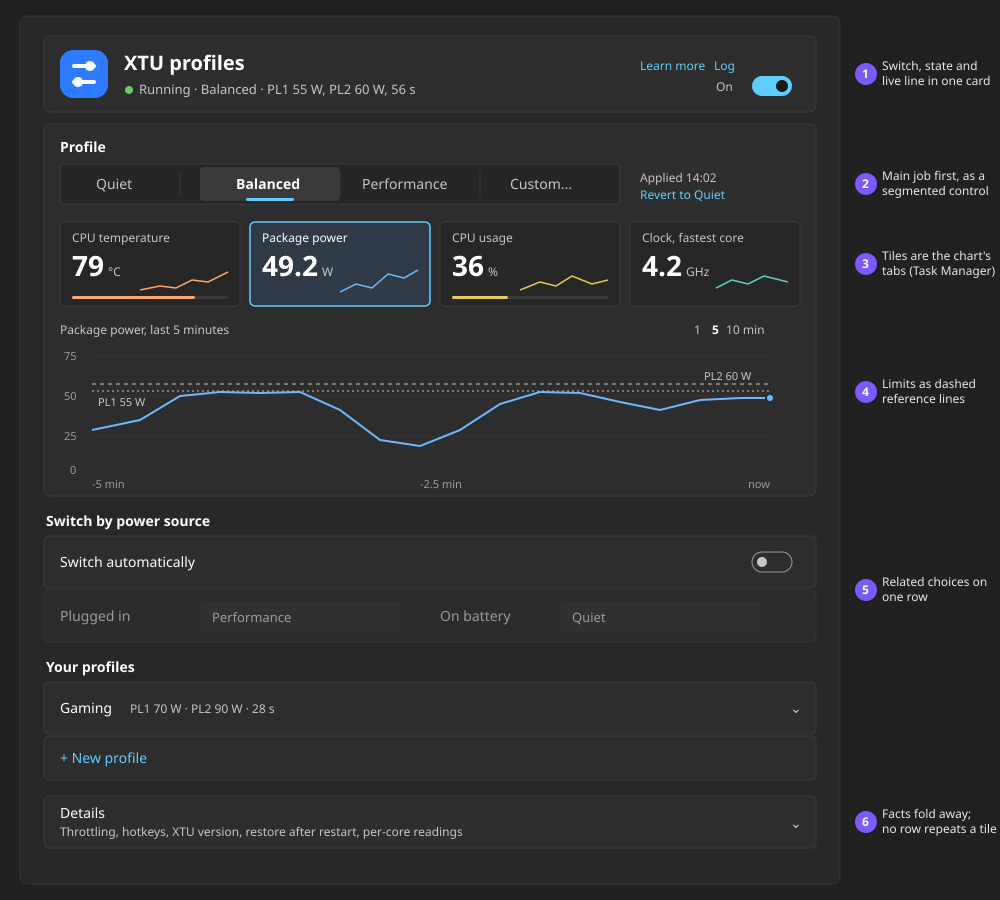

Order of the page, for every module: **header card** (switch, state) → **primary** (the module's main job) →
**tiles** (≤ 4, they select the chart) → **chart** (one series, references dashed) → **groups** of settings →
**Details** expander (facts, rarely used settings, all other readings). Each block is optional; an empty block is not drawn.

### 2. Dashboard: the machine first, then each module's main control

Before: `img/01-dashboard.png`.

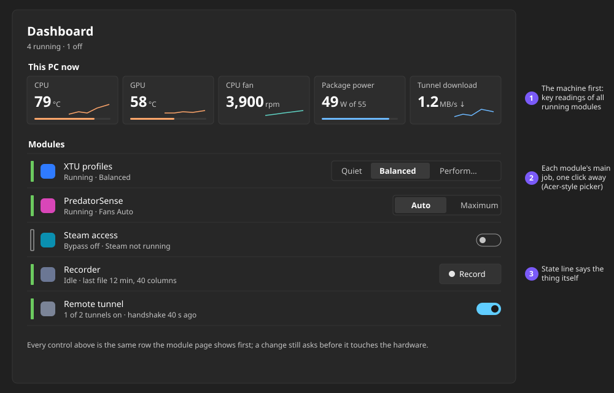

### 3. PredatorSense: the big mode picker, done with Fluent controls

Before: `img/10-predatorsense.png` (fan mode about 1,400 px down).

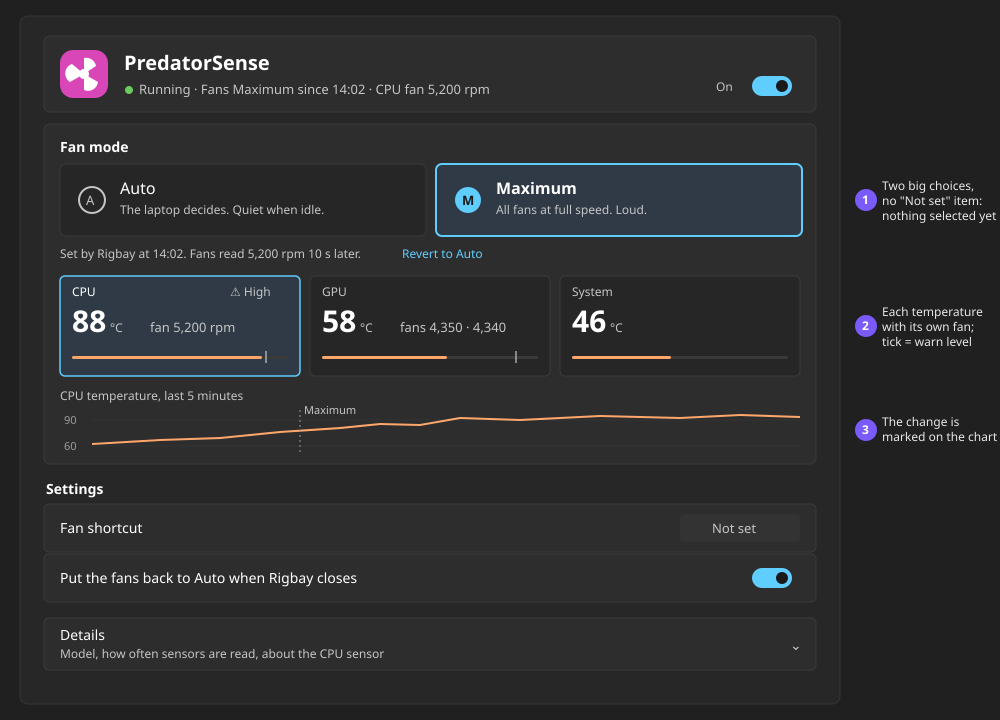

### 4. Remote tunnel: state and switch in each row

Before: `img/14-tunnel.png`.

```
Remote tunnel                                                         WireGuard for Windows · Log
● Running · 1 of 2 tunnels on                                                          [ On  ●]
-----------------------------------------------------------------------------------------------
Tunnels
┌─────────────────────────────────────────────────────────────────────────────────────────────┐
│ example-tunnel                                                                   [ On  ●] ⌄ │
│ Connected · handshake 15 s ago · ↓ 17.6 KB/s  ↑ 2.4 KB/s  ~~~~~~                             │
├─────────────────────────────────────────────────────────────────────────────────────────────┤
│ example-backup                                                                   [ Off ○] ⌄ │
│ Off                                                                                         │
└─────────────────────────────────────────────────────────────────────────────────────────────┘
  (opened: Start with Windows [○] · Turn off after [Never v] · Public address [______]
           Check a local service on port [____] · Shortcut [Not set]
           Server, transferred today, last problem: in a "Details" line, only when they have a value)
```

### 5. Narrow window (640 px): the menu button comes back, tiles go 2 by 2, the primary control stays first

Before: `img/02-dashboard-640.png`, `img/08-xtu-640.png`.

```
┌──────────────────────────────────────────────┐
│ ☰  [U] Rigbay   [ Search (Ctrl+F)        ]   │   menu button visible below 500 px;
├────┬─────────────────────────────────────────┤   icon rail from 500 to 1000 px
│ ⌂  │ [tile] XTU profiles          [ On  ●]   │
│ ═  │ ● Running · Balanced                    │
│ ❄  │ Profile                                 │
│ ⇄  │ [ Quiet | Balanced | Perform… | … ]     │   segmented scrolls sideways, or a combo under 520 px
│ ●  │ ┌─────────┐ ┌─────────┐                 │
│    │ │ CPU 79°C│ │ 49.2 W  │                 │   tiles 2 by 2 (V1 does this already)
│    │ └─────────┘ └─────────┘                 │
│ ⚙  │ chart (190 px)                          │
└────┴─────────────────────────────────────────┘
```

## Work packages

Three packages for the host that can run in parallel, then module adoption. No file is in two packages.

**Step 0, before the packages start** (one person, S, no behaviour change): split `Ui/Pages.cs` into
`Ui/DashboardPage.cs`, `Ui/ModulePage.cs`, `Ui/RequiresDialog.cs`, `Ui/SettingsPage.cs`, `Ui/LogPage.cs`; in
`lang/en.lang` and `lang/vi.lang` add two marker comments in different places (`# --- WP-A keys ---` after the
dashboard block, `# --- WP-B keys ---` after the module page block). A and B add their new keys only under their marker;
C owns every existing line. Merge step 0 to `main` first.

| Package | Owns these files | Findings | Size |
| --- | --- | --- | --- |
| **A. Shell, navigation, Dashboard, Modules, Settings, Log, tray** | `MainWindow.xaml`, `MainWindow.xaml.cs`, `Ui/DashboardPage.cs`, `Ui/ModulesPage.cs`, `Ui/SettingsPage.cs`, `Ui/LogPage.cs`, `Ui/UiKit.cs`, `Ui/ModuleIconUi.cs`, `Services/TrayHost.cs`; new keys under `# --- WP-A keys ---` | SH-1 to SH-6, DB-1 to DB-3, DB-7, DB-4 (after B's MP-1 is merged), MD-1 to MD-3, FR-1, SE-1, SE-3, LG-1, TR-1, AX-3, LC-3, the `ModulesPage` half of DL-1 | M to L |
| **B. Module page, renderer, page model, visual readings** | `src/Rigbay.Abstractions/PageModel.cs`, `src/Rigbay.Core/Editing/ReadingPlan.cs`, `ReadingScale.cs`, `ReadingFormat.cs`, `Ui/ModulePage.cs`, `Ui/RowRenderer.cs`, `Ui/ReadingBlock.cs`, `Ui/ReadingTile.cs`, `Ui/TrendChart.cs`, `Ui/Sparkline.cs`, `Ui/ChartKit.cs`, `Styles.xaml`, `tools/demo-modules/*`, `docs/ABSTRACTIONS.md`, `docs/UI-DIRECTION.md`; new keys under `# --- WP-B keys ---` | MP-1 to MP-9, VR-1 to VR-8, AX-4, AX-5, the host part of LC-2 | L |
| **C. Dialogs, notifications, copy, localisation** | `Ui/Approval.cs`, `Ui/CaptureDialog.cs`, `Ui/RequiresDialog.cs`, `Services/InAppNotice.cs`, `Services/ToastHost.cs`, every existing line of `lang/en.lang` and `lang/vi.lang`, `docs/USER-GUIDE.md`, `docs/WRITING-A-MODULE.md` | AX-1, AX-2, DL-1 (its dialogs), DL-2, DB-6, MD-4, SE-2, the copy rule of LC-2 | S to M |
| **B2. Module pages** (after B's page-model additions are on `main`; one implementer per module repo, in parallel) | `modules/xtu/**`, `modules/predatorsense/**`, `modules/steambypass/**`, `modules/recorder/**`, `modules/tunnel/**` (each a separate repo and release) | XT-1 to XT-4, PS-1, PS-2, SA-1, RC-1, TN-1, TN-2, DB-5, LC-1, the module part of LC-2 | S each |

Order inside B, so B2 can start early: (1) `PageModel.Primary`, `ExpanderRow.HeaderRow`/`Line`, `ReadingRow.ChartRole`,
`Warn`, `Secondary`, `ButtonRow.ConfirmKey` with their renderer support (MP-1, MP-6, VR-4, VR-6, MP-9), merged on their
own; (2) the rest. Every addition is optional and additive, so host API 0.1 stays (as V1 did). A module that sets none
of them still gets MP-2, MP-3, MP-4, VR-1, VR-2, VR-3 for free.

Acceptance for every package: `tools/shots.ps1` renders of the touched screens at 1240 and 640 px, dark and light,
English and Vietnamese, looked at; the self-test passes; no new string without its Vietnamese line (`--langcheck`).

## Not verified

- **High contrast.** The OS theme was not switched; the reading hues and V1's dash patterns have high-contrast entries
  that nobody has seen.
- **Screen readers.** Names were read from the code, not heard with Narrator.
- **Real 150 % and 200 % monitors.** `--shot-scale` renders only; 150 % looked sharp.
- **The tray menu and a notification banner on screen.** Read from the code (`TrayHost.BuildModel`, `InAppNotice`);
  the N1 in-window bar was not rendered (its trigger needs a confirmed change or a failure).
- **The shortcut capture dialog and search results** were reviewed from code; no script step opens them.
- **The released XTU and PredatorSense modules are older than `main`'s module sources** (N1 changes are not released);
  the pages were reviewed as the owner has them.
- **Acer PredatorSense** was not opened; the comparison uses the owner's description.
